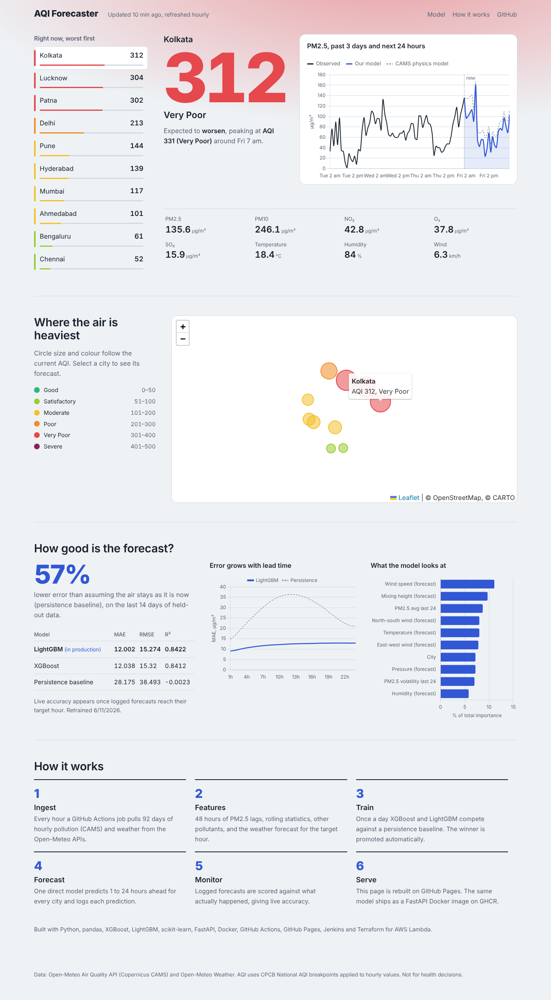
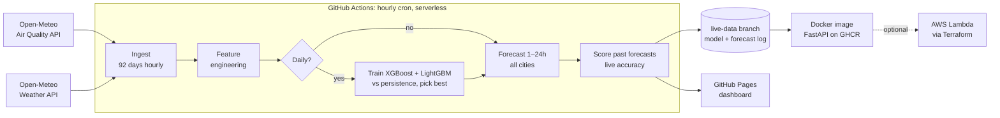

# AQI Forecaster: real-time air quality forecasting for Indian cities

[](https://github.com/PalakGupta7456/aqi-forecaster/actions/workflows/ci.yml)
[](https://github.com/PalakGupta7456/aqi-forecaster/actions/workflows/pipeline.yml)


**Live dashboard: https://palakgupta7456.github.io/aqi-forecaster/**

An end-to-end, fully serverless machine-learning system. Every hour it pulls live pollution and weather data for 10 Indian cities, forecasts PM2.5 and AQI for the next 24 hours, checks how accurate its earlier forecasts were, and republishes an interactive dashboard. No server runs between updates and the whole system costs nothing to operate.



## Results

Measured on the last 14 days of data, held out from training:

| Model | MAE (µg/m³) | RMSE | R² |
|---|---|---|---|
| Persistence baseline ("air stays as it is now") | 28.2 | 38.5 | 0.00 |
| XGBoost | 12.0 | 15.3 | 0.84 |
| **LightGBM (in production)** | **12.0** | **15.3** | **0.84** |

The numbers above come from the offline synthetic run. The live dashboard shows the current figures from real data, including **live accuracy**: every forecast is logged and scored once its target hour has passed.

## Architecture



## How it works

**1. Data ingestion** (`src/aqi/ingest.py`). Two HTTP calls fetch hourly PM2.5, PM10, NO₂, O₃, SO₂ and CO (from the Copernicus CAMS model, via Open-Meteo) plus temperature, humidity, wind, pressure, rain and boundary-layer height for all cities. No API key is needed. Requests retry with exponential backoff.

**2. Feature engineering** (`src/aqi/features.py`). This is a *direct multi-horizon* setup: each training row is (city, issue hour *t*, horizon *h*) and the target is PM2.5 at *t+h*. One model covers all 24 horizons.
- Known at time *t*: PM2.5 lags (1 to 48 h), rolling means and standard deviations, recent changes, other pollutants.
- Known for the target hour *t+h*: the **weather forecast** (wind, mixing height, rain, humidity), plus the hour of day and day of week encoded as sine and cosine.
- Wind direction is converted to u/v vector components, so 359° and 1° are treated as close.
- A unit test checks for **future leakage**: no feature may contain information from after time *t*, except the weather forecast.

**3. Training and model selection** (`src/aqi/train.py`). XGBoost and LightGBM are trained on a **time-based split**, never a random split, which would leak future information. They compete against a persistence baseline, and the best model by MAE is retrained on all data and promoted. Error by horizon and feature importance are saved for the dashboard. Optional MLflow logging can be turned on with `MLFLOW_LOG=1`.

**4. Forecasting and monitoring** (`src/aqi/predict.py`). Produces the 24-hour forecast, converts it to India's **National AQI (CPCB breakpoints)**, and appends every prediction to a 30-day log. Once a target hour arrives, the prediction is scored against what actually happened.

**5. Serving.**
- **Dashboard** (`docs/`): a static site with Chart.js and Leaflet, rebuilt hourly on GitHub Pages.
- **REST API** (`api/main.py`): FastAPI with `/forecast/{city}`, `/model`, `/cities` and `/health`. It is packaged as a multi-stage, non-root Docker image with a health check, published to GitHub Container Registry.
- **AWS Lambda** (`infra/terraform/`): the same image runs on Lambda through the AWS Lambda Web Adapter. Terraform creates ECR, the IAM role, the Lambda function and a public function URL.

## CI/CD

| Workflow | Trigger | What it does |
|---|---|---|
| `ci.yml` | every push and pull request | ruff lint, trains on synthetic data, pytest (unit and API tests), builds the Docker image, smoke-tests the container, pushes it to `ghcr.io` |
| `pipeline.yml` | hourly cron and manual | ingest, retrain (daily), forecast, score, save state to the `live-data` branch, deploy GitHub Pages |
| `deploy-aws.yml` | push to `api/`, `src/` or `infra/` | builds the image, pushes to ECR, Terraform deploys Lambda. Skipped when AWS secrets aren't set |
| `Jenkinsfile` | Jenkins | the same lint, test, build and push pipeline for teams that use Jenkins |

**Why the `live-data` branch?** GitHub Actions runners are stateless. The trained model and forecast log are kept as a single, force-pushed commit on a separate branch, so `main` history stays clean and the pipeline needs no database or cloud storage.

## Run it yourself

```bash
git clone https://github.com/PalakGupta7456/aqi-forecaster && cd aqi-forecaster
pip install -e ".[api,dev]"

python -m aqi.ingest        # live data   (or: python -m aqi.synthetic  for offline data)
python -m aqi.train         # train and compare models
python -m aqi.predict       # writes docs/data/forecast.json
python -m http.server -d docs 8080   # dashboard at http://localhost:8080

uvicorn api.main:app --reload        # API docs at http://localhost:8000/docs
pytest                               # tests
```

With Docker:

```bash
docker build -t aqi-forecaster .
docker run -p 8000:8000 aqi-forecaster
curl localhost:8000/forecast/delhi
```

## Deploy to AWS (optional)

1. Create an AWS free-tier account and an IAM user with access to Lambda, ECR, IAM, CloudWatch Logs and S3.
2. Create an S3 bucket in `ap-south-1` for Terraform state.
3. In this repo go to **Settings → Secrets and variables → Actions** and add `AWS_ACCESS_KEY_ID`, `AWS_SECRET_ACCESS_KEY` and `TF_STATE_BUCKET`.
4. Run the **Deploy API to AWS Lambda** workflow. The API URL appears in the run summary.

## Limitations and next steps

- Open-Meteo pollution values come from the CAMS atmospheric model, not ground sensors. Adding CPCB or OpenAQ station data as the target would make this a model-correction ("downscaling") problem.
- Official NAQI uses 24-hour averages. Here the same breakpoints are applied to hourly values as a now-cast.
- Possible next steps: quantile regression for uncertainty bands, a drift alert when live MAE degrades, and adding more cities.

## Project structure

```
src/aqi/        ingest, features, train, predict, AQI index, synthetic data
api/            FastAPI service
docs/           dashboard (GitHub Pages)
tests/          pytest: AQI maths, leakage, end-to-end training, API
infra/terraform AWS Lambda + ECR
.github/workflows  CI, live pipeline, AWS deploy
Jenkinsfile     Jenkins pipeline
```
